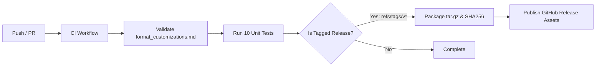

# Antigravity 自定義系統格式與架構標準 (Antigravity Customization Standards)

[](https://github.com/shiroiyuki/antigravity_format_rule/actions/workflows/ci.yml)
[](https://opensource.org/licenses/MIT)
[](https://www.python.org/)

本專案收錄並維護 Google Antigravity (AGY) 體系之核心規範檔案 `format_customizations.md`，並提供深入的底層技術原理解析、一鍵部署腳本、確定性合規驗證工具與 CI/CD 發布流程。

本規範完全基於對 `agy` 官方二進位執行檔（Go 1.28 核心架構）的逆向工程與符號控制流分析編纂而成，杜絕任何經驗主義或猜測，直指 Antigravity 五大自定義組件（Rules / Skills / Agents / Hooks / Plugins）的底層判定機制。

---

## 為什麼需要這份規範？（核心痛點與災難現場）

在 Antigravity 體系中，Agent 擁有高度自主權，但其自定義組件的載入是由底層 Go 二進位引擎確定性驅動的。若缺乏精確的語法約束，會引發嚴重的**靜默失效（Silent Failure）**與**能力殘缺**：

### 1. 痛點一：子代理靜默降級為唯讀（Write Tools 遺失）
- **錯誤寫法**：許多開發者習慣將動態調用參數（如 `enable_write_tools: true`、`enable_mcp_tools: false`）直接寫在 `agent.md` 的 YAML Frontmatter。
- **底層真相**：Go 底層反序列化結構體為 `customizations.AgentFrontmatter`，**完全沒有宣告這些欄位的 YAML 標籤**。
- **災難後果**：`yaml.Unmarshal` 遇到未定義欄位會靜默丟棄；而當 `tools` 欄位被省略時，底層引擎僅為該 Agent 掛載最小唯讀工具集（`read_file`、`search_web` 等）。導致子代理在執行寫入任務或輸出帶外日誌時因缺少 `write_file` / `run_command` 直接崩潰。

### 2. 痛點二：規則靜默丟棄（`Invalid rule trigger`）
- **錯誤寫法**：在獨立規則檔 `rules/*.md` 的 YAML 標頭中填入 `always_on: true`，或完全省略 `trigger`。
- **底層真相**：`RuleFrontmatter` 僅宣告 `yaml:"trigger"`。底層規則分類引擎（`categorizeRule`）在讀取時，若比對不到合法的 Trigger 枚舉值（`always_on`、`model_decision`、`glob`、`manual`），便會直接觸發內部錯誤 `Invalid rule trigger: 0`。
- **災難後果**：該規則被底層引擎無警告丟棄，完全無法參與模型推理，造成安全規範或業務流程形同虛設。

### 3. 痛點三：Plugin 內部規則誤用 Frontmatter 導致常駐失效
- **錯誤寫法**：在 Plugin 的 `rules/AGENTS.md` 內加入 YAML Frontmatter。
- **底層真相**：底層規則解析函式（`parseRuleInfo`）存在硬編碼雙分支判定：凡檔名為 `AGENTS.md` 或 `GEMINI.md` 者，底層強制直接指定為 `always_on` 並跳過 Frontmatter 解析器（`SplitMarkdownFrontmatter`）。
- **災難後果**：若在 `AGENTS.md` 內試圖使用 `trigger: model_decision` 進行按需動態路由，將完全無效，強行常駐消耗 Token。

### 4. 痛點四：Token 預算擊穿（20K Token Rules Budget 溢位）
- **錯誤寫法**：將大量易變的演算法程式碼、Python 實作或繁複的 CLI 範例直接塞在 Rule 內。
- **底層真相**：`agy` 為 Always-on 與 Global 規則分配了獨立的 **20,000 Tokens 專用預算（`defaultRulesBudget`）**，且單一規則檔案硬編碼上限為 **24 KB（24,000 bytes）**。
- **災難後果**：超出預算的規則會被系統自動降級為純檔案路徑指針（Pointer），模型不再能直接讀取內容；超額檔案則會在行邊界被硬性截斷。

---

## 逆向核心技術結論（底層引擎行為矩陣）

| 組件 | 底層解析函式 / 結構體 | 確定性行為特徵 | 關鍵語法要求 |
| :--- | :--- | :--- | :--- |
| **Rules (`rules/*.md`)** | `parseRuleInfo`<br>`categorizeRule` | 1. 檔名為 `AGENTS.md` / `GEMINI.md` 時硬編碼為 `always_on`，跳過 Frontmatter 解析。<br>2. 其餘 `.md` 強制解析 Frontmatter，非法 Trigger 觸發 `Invalid rule trigger` 拋棄。 | 必須宣告 `trigger:`（值限 `always_on`、`model_decision`、`glob`、`manual`）。 |
| **Agents (`agent.md`)** | `AgentFrontmatter`<br>`ParseAgentScriptItemFromMarkdown` | 1. 僅識別原生 Frontmatter 標籤。<br>2. 省略 `tools` 僅給予唯讀權限。<br>3. `subagent: true` 自動注入 `send_message`。<br>4. 系統提示詞（System Prompt）必須以 `# H1` 分界。 | 顯式宣告 `tools: [read_file, write_file, ...]`；若為純後台工位可設 `mainAgent: false`。 |
| **Skills (`SKILL.md`)** | `parseSkillMetadata`<br>`ParseWorkflowContent` | 透過 `Progressive Disclosure`（漸進式揭露）機制運作，平時僅向模型上下文注入 `name` 與 `description`。 | 必須具備 `name` 與明確動詞引導的 `description`。 |
| **Plugins (`plugin.json`)** | `PluginCatalogKey`<br>`parseRuleInfo` | 命名空間容器。嚴格規定原生外掛之 `hooks.json` 必須置於外掛根目錄；`rules/` 下之 `AGENTS.md` 自動常駐。 | 根目錄必須具備 `plugin.json`。 |

---

## 一鍵安裝與部署（Installation）

專案內建支援 POSIX 規範的自動化安裝腳本 `install.sh`，支援從遠端一鍵拉取或本地儲存庫部署。

### 1. 遠端一行指令安裝 (Remote One-Liner)

#### 全域安裝（推薦，所有專案皆適用）：
```bash
curl -fsSL https://raw.githubusercontent.com/shiroiyuki/antigravity_format_rule/main/install.sh | bash
```
> 安裝路徑：`~/.gemini/config/rules/format_customizations.md`

#### 當前專案工作區安裝（僅當前專案生效）：
```bash
curl -fsSL https://raw.githubusercontent.com/shiroiyuki/antigravity_format_rule/main/install.sh | bash -s -- --workspace
```
> 安裝路徑：`./.agents/rules/format_customizations.md`

### 2. 本地儲存庫安裝 (Local Installation)

若已 Clone 本儲存庫，可直接執行本地安裝：
```bash
# 全域安裝
./install.sh --global

# 當前專案工作區安裝
./install.sh --workspace
```

---

## 規格合規驗證工具（Validator CLI）

專案提供高效能、零外部依賴的規格校驗工具 `scripts/validate.py`，嚴格依據 `agy` 逆向結果進行邊界審查。

### 特色功能
- **零外部依賴**：內建純 Python 正則解析器，在未安裝第三方庫環境下立即可用；若環境存在 `PyYAML` 則自動升級使用。
- **多維度自動診斷**：
  - 檢測檔案大小是否超過 **24,000 bytes** 上限。
  - 檢測 `rules/*.md` 是否合法配置 `trigger:`（攔截 `always_on: true` 錯誤語法）。
  - 檢測 `agent.md` 是否誤用 `enable_write_tools` / `enable_mcp_tools` 等無效標籤。
  - 檢測 `agent.md` 是否遺漏顯式 `tools` 清單（防止靜默降級為唯讀）。
  - 檢測 `agent.md` 正文是否具備 `# H1` 系統提示詞標頭。

### 使用範例

```bash
# 1. 驗證本專案規範本體
python scripts/validate.py format_customizations.md

# 2. 遞迴驗證全域所有規則與 Agent 設定
python scripts/validate.py ~/.gemini/config/rules ~/.gemini/config/agents

# 3. 遞迴驗證特定專案工作區
python scripts/validate.py .agents/rules .agents/agents
```

### 驗證輸出示範
```text
=== Antigravity 規格合規驗證開始 ===
[PASS] format_customizations.md

=== 驗證總結 ===
通過: 1 | 失敗: 0
```

---

## 自動化測試與 CI/CD 發布流程（GitHub Actions）

本專案配置了企業級的自動化持續整合與發布流水線（`.github/workflows/ci.yml`）：



### 1. 持續整合（CI）
- 任何推送到 `main` 分支的提交或 Pull Request，GitHub Actions 自動於乾淨虛擬機器環境執行：
  1. 執行 `scripts/validate.py format_customizations.md` 確保規範本身合法。
  2. 執行 `python -m unittest discover tests` 執行 10 個核心單元測試。

### 2. 本地執行單元測試
在提交 PR 之前，可於本地執行單元測試套件：
```bash
python -m unittest discover tests
```
測試結果：
```text
Ran 10 tests in 0.020s
OK
```

### 3. 自動化版本發布（Release Flow）
當為版本打上語義化標籤（Semantic Versioning）並推送到 GitHub 時，自動觸發 Release Job：
```bash
git tag -a v1.0.0 -m "Release v1.0.0: Initial Antigravity Customization Standards"
git push origin v1.0.0
```
- **發布產物**：
  - `antigravity_format_rule-v*.tar.gz`（包含規範、腳本與工具）
  - `antigravity_format_rule-v*.tar.gz.sha256`（完整性校驗雜湊值）
  - 原生 `format_customizations.md`
  - 一鍵安裝腳本 `install.sh`

---

## 實戰配置與目錄結構

### 1. 雙層檔案路徑標準

Antigravity 遵循「**工作區本地優先，全域回退（Workspace Overrides Global）**」原則：

```text
├── 全域通用配置 (~/.gemini/config/)          # 所有專案通用底座
│   ├── rules/                              # 全域通用安全與環境約束
│   ├── skills/                             # 全域通用原子工具庫
│   ├── agents/                             # 全域預設子代理人設
│   ├── hooks.json                          # 全域生命週期自動化
│   └── plugins/                            # 跨專案通用外掛套件
│
└── 專案本地配置 (<project_root>/.agents/)     # 當前專案優先覆蓋
    ├── rules/                              # 專案特定業務規範
    │   └── AGENTS.md                       # 專案階段性 SOP (常駐)
    ├── skills/                             # 專案專用腳本工具
    ├── agents/                             # 專案客製化專業工位
    ├── hooks.json                          # 專案防禦與自動化鉤子
    └── plugins/                            # 專案專用套件 (或 plugins.json)
```

---

### 2. 各組件撰寫範本

#### A. 獨立規則檔 (`rules/domain_router.md`)
用於按需路由特定領域知識（如資料庫操作、前端規範、逆向工程），平時僅佔用一行摘要：
```yaml
---
trigger: model_decision
description: "當處理資料庫 Migration、Schema 變更或索引優化時觸發載入"
---

# 資料庫工程與變更守則
1. 嚴禁在未備份情況下執行 DROP / TRUNCATE。
2. 所有欄位變更必須具備向下相容性。
```

#### B. 技能描述檔 (`skills/my_tool/SKILL.md`)
原子動作工具箱，具備自包含性與跨環境動態路徑支援：
```markdown
---
name: my-linter
description: "執行專案靜態代碼分析與型別安全檢查 (linter.py)"
---

# 代碼檢查技能

## 執行命令
```bash
SCRIPT_PATH="$([ -f .agents/skills/my_tool/scripts/linter.py ] && echo .agents/skills/my_tool/scripts/linter.py || echo ~/.gemini/config/skills/my_tool/scripts/linter.py)"
~/gemini_py3_env/bin/python "$SCRIPT_PATH" --target .
```
```

#### C. 子代理人設檔 (`agents/architect/agent.md`)
專業分工工位，依角色最小權限原則分配工具集，支援帶外日誌輸出：
```markdown
---
name: architect
description: "系統架構設計與型別骨架專家，負責系統介面與模組合約設計"
model: pro
subagent: true
mainAgent: false     # 純背景工位，從主對話 /agents 選單隱藏以保持整潔
inheritMcp: false
tools:
  - read_file
  - write_file       # 允許寫入日誌與骨架草案
  - run_command
  - manage_task
---

# 架構設計師角色規範
你是一名專業軟體架構師。
你的任務是設計 Type Hints 與 Interface。
嚴禁撰寫業務邏輯實作。
```

---

### 3. 五位一體職責解耦原則

為保持系統長期演進且不膨脹，嚴格遵守職責邊界：
- **Rule（政策與驗收門檻）**：定義「要做什麼（What）」與驗收標準。**嚴禁包含易變的實體 Python 腳本**。
- **Skill（實體工具與執行能力）**：定義「如何做（How）」。封裝可執行的腳本、CLI 工具與單元測試。
- **Agent（專業工位與寫入邊界）**：定義「由誰做（Who）」。配置獨立思考口吻與最小必要工具。
- **Hook（確定性防護與生命週期）**：定義「何時觸發（When）」。在 `SessionStart`、`PreToolUse` 等事件自動攔截。
- **Plugin（打包容器）**：定義「套件範疇（Where）」。整合特定子系統的所有組件。

---

## 授權與維護
- 規範文件：`format_customizations.md`
- 遵循標準：Google Antigravity Customization Architecture & AGY CLI Specification
- 維護者：[shiroiyuki](https://github.com/shiroiyuki)
- License: [MIT](LICENSE)
